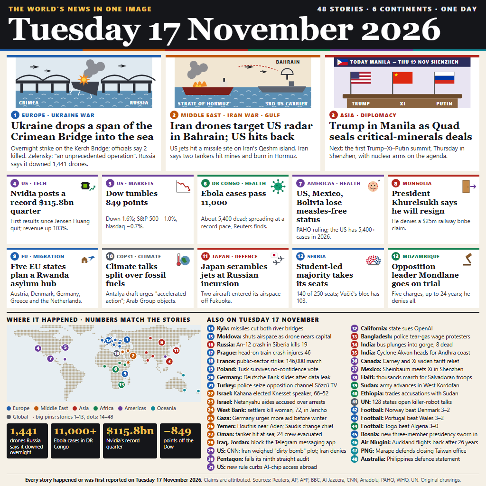

# The world's news in one image: Tuesday 17 November 2026

[](https://make.fun/bounty/news-image-20261117)
[](https://make.fun/bounty/news-image-20261117)
[](https://make.fun/bounty/news-image-20261117)

An entry for the make.fun bounty [Sum up 17 November's world news in one image](https://make.fun/bounty/news-image-20261117).



A one-page front page of 48 stories from six continents: three illustrated lead
stories, ten tiles, a dot-matrix world map with numbered pins, the day in numbers
and a list of 35 more stories. Every story happened or was first reported on
Tuesday 17 November 2026.

## How it works

- `main.py` (Python 3.13, standard library only) checks `entry.png` against the
  bounty's rules (PNG, at most 1 MiB and 1024x1024) and writes it to `/output`
  (or `$MAKEFUN_OUTPUT_DIR`). It needs no network and writes the same bytes every run.
- `design/page.html` is the source of the image. It builds itself from
  `design/art.js` (original SVG drawings) and `design/worldmap.js` (a dot-matrix
  map drawn from hand-written coastline outlines).
- `design/render.ps1` re-renders `entry.png` with headless Chrome.

```
mkdir out
MAKEFUN_OUTPUT_DIR=out python main.py
```

Sources: Reuters, AP, AFP, BBC, Al Jazeera, CNN, Anadolu, PAHO, WHO and UN reports
of 17 November 2026. All drawings are original.

License: MIT.
